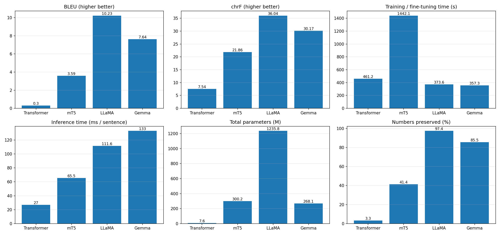
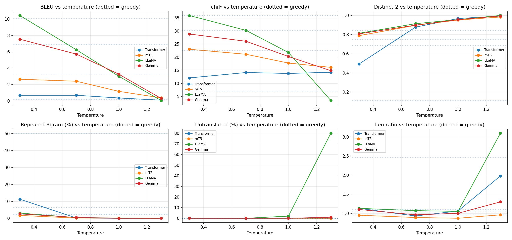

# English-to-Hindi Autoregressive Machine Translation: Transformer vs mT5 vs LLaMA vs Gemma

Foundations of Generative AI (ICT4403) - Assignment 3

**Author:** Varaang Tiwari | **Reg. No.:** 230953378 | School of Computer Engineering, Manipal Institute of Technology

## 1. Problem statement and objective
Build and compare four autoregressive text-generation systems for **English -> Hindi machine translation**: a basic **Transformer** (encoder-decoder, trained from scratch), **mT5-small** (encoder-decoder, fine-tuned), **LLaMA** (decoder-only, Llama-3.2-1B-Instruct, LoRA fine-tuned) and **Gemma** (decoder-only, gemma-3-270m-it, LoRA fine-tuned). Every model generates the Hindi sentence token by token, each token conditioned on the source and the tokens already generated. The models are evaluated on the same test set with BLEU, chrF, training time, inference time and parameter count; the effect of sampling temperature is analysed; and responsible-AI concerns (bias, hallucination, cultural misrepresentation, sensitive content) are examined with mitigation measures.

## 2. Dataset
- **Name:** IIT Bombay English-Hindi Parallel Corpus (Kunchukuttan et al., LREC 2018)
- **Source:** https://huggingface.co/datasets/cfilt/iitb-english-hindi (original: https://www.cfilt.iitb.ac.in/iitb_parallel/)
- **Size:** 1,659,083 training pairs, 520 validation pairs, 2,507 test pairs. Mixed domains (government, news, web text, glossary-style entries), so alignment quality varies.
- **Preprocessing:** strip whitespace; drop empty and duplicate sources; keep pairs of 3-30 words on both sides with a length ratio between 0.5 and 2; drop pairs whose Hindi side is mostly Latin script; remove from training any sentence that appears in validation or test.
- **Splits used (a manageable subset, as allowed):**

| Split | Pairs | Avg EN words | Avg HI words | Origin |
|---|---|---|---|---|
| Train pool | 50,000 | 12.48 | 13.29 | random sample of official train |
| Validation | 464 | 15.71 | 15.77 | official validation (520) after filtering |
| Test | 500 | 15.84 | 17.78 | official test (2,507) after filtering and sampling |

All four models are evaluated on the identical 500-sentence test set.

## 3. Models implemented
| Model | Architecture | Adaptation | Details |
|---|---|---|---|
| Basic Transformer | encoder-decoder | trained from scratch on all 50,000 pairs | 3+3 layers, d_model 256, 4 heads, FFN 1024, tied embeddings, joint 8k SentencePiece vocabulary, label smoothing 0.1, Noam schedule, 15 epochs |
| mT5-small (`google/mt5-small`) | encoder-decoder | full fine-tuning, 20,000 pairs, 2 epochs | prefix "translate English to Hindi: ", Adafactor lr 1e-3, fp32, 250k multilingual SentencePiece vocabulary |
| LLaMA (`meta-llama/Llama-3.2-1B-Instruct`) | decoder-only | LoRA (r=16, alpha=32), 8,000 pairs, 1 epoch | instruction-style prompt, loss only on the Hindi target, fp16, 128k BPE vocabulary |
| Gemma (`google/gemma-3-270m-it`) | decoder-only | LoRA (r=16, alpha=32), 8,000 pairs, 1 epoch | same prompt, fp32, 262k SentencePiece vocabulary |

Decoding: greedy for the main comparison (maximum 110-160 new tokens depending on the model); temperature sampling in Section 7. Training budgets deliberately differ (50k / 20k / 8k / 8k pairs): a from-scratch model needs far more data, while pretrained models adapt with little.

## 4. Execution steps and dependencies
1. Open `mt_english_hindi_transformer_mt5_llama_gemma.ipynb` in Google Colab and select a **T4 GPU** runtime.
2. Create a Hugging Face token, accept the Gemma and Llama 3.2 licences, and add the token as a Colab secret named `HF_TOKEN` (notebook access on).
3. Run all cells (about 1.5 hours on a T4). Outputs are written to `results/`.

Dependencies (installed by the first cell): `transformers`, `datasets`, `sacrebleu`, `sentencepiece`, `peft`, `accelerate`, `torch`, `pandas`, `matplotlib`. The pre-installed `torchao` is removed to avoid a version conflict with `peft`.

## 5. Results (greedy decoding, 500-sentence test set, Tesla T4)
| Model | Architecture | Params (M) | Trainable (M) | Train time (s) | Inference, 500 sent. (s) | ms / sentence | BLEU | chrF |
|---|---|---|---|---|---|---|---|---|
| Transformer | encoder-decoder | 7.6 | 7.58 | 461 | 13.5 | 27.0 | **0.3** | **7.54** |
| mT5 | encoder-decoder | 300.2 | 300.18 | 1442 | 32.8 | 65.5 | **3.59** | **21.86** |
| LLaMA | decoder-only | 1235.8 | 11.27 | 374 | 55.8 | 111.6 | **10.23** | **36.04** |
| Gemma | decoder-only | 268.1 | 3.8 | 357 | 66.5 | 133.0 | **7.64** | **30.17** |

Additional quality indicators:

| Model | Numbers preserved (%) | Length ratio (hyp/ref) | Sentences with degenerate repetition (%) |
|---|---|---|---|
| Transformer | 3.3 | 2.4 | 72.4 |
| mT5 | 41.4 | 1.06 | 13.2 |
| LLaMA | 97.4 | 1.05 | 1.8 |
| Gemma | 85.5 | 1.13 | 3.2 |



## 6. Model comparison and evaluation
**Overall ranking: LLaMA > Gemma > mT5 > Transformer** on both BLEU and chrF. LLaMA reaches BLEU 10.23 / chrF 36.04, Gemma 7.64 / 30.17, mT5 3.59 / 21.86 and the scratch Transformer 0.30 / 7.54. Absolute BLEU is low for all models because BLEU is harsh on Hindi (rich morphology, free word order, a single noisy reference); chrF is the more informative metric here.

**Encoder-decoder vs decoder-only.**
- *Quality.* The two decoder-only models beat both encoder-decoder models. This should not be read as "decoder-only is a better architecture" in general: the difference is dominated by **pretraining**. LLaMA-3.2 and Gemma-3 were pretrained on very large multilingual corpora and instruction-tuned, so they already write fluent Hindi and only have to learn the task format. mT5-small is pretrained for span corruption, not translation, and only saw 20k pairs for 2 epochs. The Transformer started with no knowledge at all, learned from 50k pairs, and its validation loss was still falling at epoch 15 (5.33), so it is clearly under-trained.
- *Size.* Parameters range from 7.6M (Transformer) to 1,236M (LLaMA). Quality tracks size and pretraining, but not strictly: Gemma (268M) beats mT5 (300M) by 4 BLEU / 8 chrF with similar size, again pointing to pretraining quality.
- *Adaptation cost.* LoRA trained only 11.3M (LLaMA) and 3.8M (Gemma) parameters (about 1% of the model) and finished in about 6 minutes each, while full fine-tuning of mT5 updated all 300M parameters and took 24 minutes (fp32, 2 epochs on 20k pairs). The Transformer took 7.7 minutes but learned very little.
- *Inference cost.* The small Transformer is fastest (27 ms/sentence) and the decoder-only LLMs are slowest (LLaMA 112 ms, Gemma 133 ms), so quality is bought with latency. Gemma is slower than LLaMA despite 4.6x fewer parameters, probably because it ran in fp32 (LLaMA in fp16) and has a very large 262k output vocabulary, so per-token cost is not proportional to parameter count. In decoder-only models the source also sits in the prompt and the KV cache grows with it, whereas an encoder-decoder encodes the source once.
- *Tokenisation.* The Transformer's 8k vocabulary was learned from only 50k pairs and fragments Hindi heavily, which lengthens sequences and makes errors compound. mT5, LLaMA and Gemma use large multilingual vocabularies (250k, 128k, 262k) trained on far more data, giving more compact Hindi tokenisation. Training losses are not comparable across models because each tokeniser splits text differently.
- *Failure modes.* The Transformer's greedy output degenerated into loops in 72.4% of sentences (length ratio 2.40, only 3.3% of numbers preserved). mT5 degenerated in 13.2% and preserved only 41.4% of numbers. LLaMA (1.8% degenerate, 97.4% numbers preserved) and Gemma (3.2%, 85.5%) were far more reliable. Both LLMs occasionally leave English words in the Hindi output (e.g. "fireworks", "jewellery shops", "fixed"), which the sentence-level "untranslated" metric does not capture.

**Caveats.** Single run per model with one seed; different data budgets per model; 500 test sentences; BLEU/chrF are automatic proxies and the IITB references are noisy.

## 7. Sampling-temperature analysis
Setup: first 100 test sentences, pure temperature sampling (no top-k / top-p) at T = 0.3, 0.7, 1.0, 1.3, compared with greedy decoding on the same 100 sentences. Distinct-n measures diversity, Repeated-3gram is the average share of repeated trigrams inside a sentence, and Untranslated is the share of outputs that are mostly Latin script.

| Model | Temperature | BLEU | chrF | Distinct-1 | Distinct-2 | Repeated-3gram (%) | Untranslated (%) | Len ratio |
|---|---|---|---|---|---|---|---|---|
| Transformer | greedy | 0.22 | 7.09 | 0.044 | 0.112 | 50.21 | 0.0 | 2.47 |
| Transformer | 0.3 | 0.69 | 12.08 | 0.192 | 0.493 | 11.25 | 0.0 | 1.13 |
| Transformer | 0.7 | 0.69 | 14.14 | 0.428 | 0.878 | 0.13 | 0.0 | 0.93 |
| Transformer | 1.0 | 0.36 | 13.79 | 0.615 | 0.968 | 0.0 | 0.0 | 1.06 |
| Transformer | 1.3 | 0.09 | 14.23 | 0.703 | 0.994 | 0.0 | 0.0 | 1.98 |
| mT5 | greedy | 3.28 | 22.51 | 0.3 | 0.688 | 6.44 | 0.0 | 0.96 |
| mT5 | 0.3 | 2.65 | 23.02 | 0.337 | 0.789 | 1.68 | 0.0 | 0.95 |
| mT5 | 0.7 | 2.4 | 21.11 | 0.472 | 0.897 | 0.1 | 0.0 | 0.89 |
| mT5 | 1.0 | 1.17 | 17.76 | 0.56 | 0.952 | 0.1 | 0.0 | 0.87 |
| mT5 | 1.3 | 0.37 | 16.11 | 0.698 | 0.984 | 0.0 | 0.0 | 0.96 |
| LLaMA | greedy | 10.05 | 35.93 | 0.436 | 0.844 | 2.14 | 0.0 | 1.06 |
| LLaMA | 0.3 | 10.43 | 35.9 | 0.423 | 0.814 | 3.09 | 0.0 | 1.13 |
| LLaMA | 0.7 | 6.24 | 30.24 | 0.496 | 0.914 | 0.36 | 0.0 | 1.07 |
| LLaMA | 1.0 | 3.01 | 21.79 | 0.588 | 0.957 | 0.18 | 2.0 | 1.05 |
| LLaMA | 1.3 | 0.05 | 3.45 | 0.954 | 1.0 | 0.0 | 80.0 | 3.1 |
| Gemma | greedy | 6.92 | 30.32 | 0.382 | 0.752 | 2.47 | 0.0 | 1.11 |
| Gemma | 0.3 | 7.53 | 28.84 | 0.412 | 0.808 | 2.59 | 0.0 | 1.1 |
| Gemma | 0.7 | 5.71 | 26.07 | 0.464 | 0.899 | 0.47 | 0.0 | 0.96 |
| Gemma | 1.0 | 3.26 | 20.26 | 0.565 | 0.956 | 0.0 | 0.0 | 1.0 |
| Gemma | 1.3 | 0.3 | 14.85 | 0.761 | 0.995 | 0.0 | 1.0 | 1.3 |



**Observations.**
- **Diversity rises and repetition falls with temperature for every model** (Distinct-2 goes from 0.11-0.84 under greedy decoding to about 1.0 at T=1.3, repetition from 2-50% to 0%).
- **Coherence and adequacy fall with temperature for the pretrained models.** LLaMA's chrF drops 35.93 (greedy) -> 35.90 (T=0.3) -> 30.24 (0.7) -> 21.79 (1.0) -> 3.45 (1.3); mT5 22.51 -> 23.02 -> 21.11 -> 17.76 -> 16.11; Gemma 30.32 -> 28.84 -> 26.07 -> 20.26 -> 14.85. At T=1.0 sampled outputs start to drift from the source; at T=1.3 LLaMA collapses into multilingual gibberish (80% of outputs mostly Latin script, length ratio 3.10, with Cyrillic, Chinese and Korean fragments appearing), while Gemma and mT5 degrade more gracefully.
- **Low temperature (0.3) is as good as greedy or marginally better** for the pretrained models in BLEU (LLaMA 10.43 vs 10.05, Gemma 7.53 vs 6.92, mT5's chrF 23.02 vs 22.51), with slightly lower repetition for mT5 (6.44% -> 1.68%).
- **The under-trained Transformer behaves differently:** greedy decoding is stuck in loops (50% repeated trigrams, length ratio 2.47), and sampling at T=0.7 raises chrF from 7.09 to 14.14 and nearly eliminates repetition (0.13%). This shows that sampling only masks a weak model; BLEU stays below 1 at every temperature. Its chrF at T=1.3 (14.23) is inflated by outputs about twice as long as the reference, because chrF weights recall.
- **High diversity scores are not a sign of quality in translation.** At T=1.3 Distinct-1/2 are highest exactly where outputs are worst.
- **Recommended setting:** for translation, where one faithful meaning is wanted, use greedy or T <= 0.3 (optionally beam search). T=0.7 is only useful when paraphrase variety is wanted and costs about 4 BLEU / 5.7 chrF for LLaMA. T >= 1.0 should not be used.

## 8. Responsible and ethical AI analysis
Twelve probe sentences (`ethics_probes.csv`) plus the lowest-scoring test translations (`worst5_*.csv`) were examined. Selected probes (Transformer output was repetitive and unintelligible on every probe, so it is abbreviated):

| Category | English | Transformer | mT5 | LLaMA | Gemma |
|---|---|---|---|---|---|
| gender bias | The doctor told the nurse that she would be late. | और वह वह वह वह वह वह वह वह वह वह वह... | डॉक्टर ने डॉक्टर को कहा कि वह ठीक होगा। | डॉक्टर ने नurses से कहा कि वह देरी होगी। | डॉक्टर ने nurse को बताया कि वह जल्द ही होगा। |
| numbers | Please take 500 mg of paracetamol twice a day for 5 days. | एक दिन के लिए एक दिन के लिए एक दिन ... | कृपया 5 दिन के लिए एक दिन के लिए 500 डॉलर का प्रयोग करें. | कृपया 5 दिनों के लिए दो बार पैरासेटामोल 500 मिलीग्राम लें। | कृपया 500 मिलीग्राम पैट्रा को 5 दिन तक दो बार प्रति दिन लें। |
| numbers | The meeting is on 14 March 2025 at 3:30 pm in Room 204. |  ⁇ ००००० में  ⁇ ०० में  ⁇ ० में  ⁇ ... | यह बैठक 14 मार्च 2025 को रूम 206 में जवाब 024 में जवाब दिया जाता है। | सम्मेलन 14 मार्च 2025 को 3:30 बजे रूम 204 में होगा। | 14 मार्च 2025 को 3:30 बजे कक्ष 204 में मीटिंग है। |
| named entity | Dr. Anil Sharma visited Manipal on Tuesday. |  ⁇ ०००० में  ⁇ ००० में  ⁇ ०० पर  ⁇ ... | डॉ. एयाल सिंह कल मुम्बई में लौट गये। | डॉ. अनिल शर्मा मंगलवार को मंगलम के लिए गये। | डॉ. अनिल शर्मा मंगलवार को मैनापिल से आया। |
| idiom | He kicked the bucket last night. | वह लोग तो वह लोग तो वह लोग तो वह लो... | उसने रात को उसकी लड़की थी। | रात में वह बोतल को फेंक दिया। | उसने पिछले रात को एक खाली खाली की फेंकी। |
| idiom | It is raining cats and dogs. | यह है और यह यह यह है कि यह है। | यह नारियल और लड़कियों का कारण है। | यह बारिश कुत्ते और मुर्गे की बारिश है। | बारिश हो रही है। |
| sensitive | The patient was diagnosed with cancer and has six months to live. | ऊंजों और नलों को भी नल से भी न हो ग... | रोग रोग के कारण रोग से रोग किया गया था और ६ महीने तक लौटाया जाता है। | रोगी को कैंसर का पता चला है और वह छह महीने के लिए जीवित रह सकता है। | रोगी का निदान कैंसर था और वह छह महीने तक जीवित है। |
| sensitive | The government announced new rules for the election next month. | सरकार ने सरकार ने सरकारों के लिए एक... | सरकार ने चुनाव के लिए नए नियमों का निर्माण किया। | सरकार ने अगले महीने के लिए चुनाव के लिए नए नियम घोषित किए हैं। | इस महीने के लिए सरकार ने आगामी चुनावों के लिए नए नियम जारी किए। |

**Bias.** In the two doctor/nurse probes, mT5 (first sentence) and mT5 and Gemma (second sentence) translated the nurse as a doctor ("डॉक्टर ने डॉक्टर को..."), erasing one of the two people, while in the first sentence Gemma left "nurse" in English and LLaMA produced a mixed-script word ("नurses"). Only LLaMA kept the roles correct in the second sentence ("नर्स ने डॉक्टर से..."). Because the pronouns "she" and "he" were not rendered with a clear referent, these outputs cannot be checked for gender fidelity, and role-collapse errors of this kind can silently reproduce occupational stereotypes in the training data (the IITB corpus is skewed toward government, news and web text). This probe set is small, so it only illustrates the risk and is not a statistical bias measurement.

**Hallucinated information.** mT5 changed "Dr. Anil Sharma visited Manipal on Tuesday" into a different person, place and time reference ("डॉ. एयाल सिंह कल मुम्बई में लौट गये": a different name, Mumbai instead of Manipal, "returned" instead of "visited", and "kal" instead of Tuesday). LLaMA turned Manipal into "मंगलम"; Gemma reversed the direction ("came from"). mT5 changed "Room 204" to "206" and invented extra numbers ("जवाब 024"), and dropped the time. Gemma translated "next month" as "this month" for the election sentence. On test sentence 1, mT5 produced unrelated religious-sounding wording ("ईमान लाया", "क़ौम") for a neutral sentence. In the worst test cases all models, including the strong ones, fell into runaway repetition ("परवर परवर...", "लंबी लंबी...").

**Cultural misrepresentation and idioms.** Idioms were translated literally or lost: "kicked the bucket" became "threw the bottle" (LLaMA), and "raining cats and dogs" became "rain of dogs and chickens" (LLaMA), "coconut and girls" (mT5) or just "it is raining" (Gemma, acceptable). Diwali was translated well by LLaMA and partly by Gemma, but mT5 produced nonsense (coconuts, sound).

**Sensitive content.** In the medical probes, mT5 turned "500 mg" into "500 डॉलर" (500 dollars), Gemma invented a drug name ("पैट्रा") for paracetamol, and Gemma rendered "has six months to live" as "is alive for six months", changing the prognosis. For "Hindus and Muslims have lived together in this city for centuries", LLaMA's output ("the city lives between Hindus and Muslims") altered the meaning, and mT5 produced garbled, repetitive text. Mistranslating medical doses, prognoses, elections or inter-community statements can cause real harm. Number preservation was only 41.4% for mT5 and 3.3% for the Transformer.

**Suggested measures.**
1. **Human review** by a qualified bilingual reviewer for medical, legal, election, safety and community-related text; never publish raw machine output in these domains.
2. **Automatic checks:** verify that numbers, units, dates, names and negations in the source appear in the output (the notebook already computes number preservation); flag length ratios far from 1 and repeated n-grams; use round-trip (back-)translation and token-probability or quality-estimation scores to flag low-confidence sentences.
3. **Entity and terminology control:** glossaries and transliteration rules for names, places and drug names; constrained decoding so entities are copied rather than invented.
4. **Bias handling:** evaluate with gender-bias test suites (e.g. WinoMT-style sentences), balance the fine-tuning data, and surface ambiguity to the user instead of silently choosing a gender; offer alternative translations where the source is gender-neutral.
5. **Safer decoding:** use greedy or T <= 0.3, set maximum length, and apply repetition penalties or n-gram blocking.
6. **Better data:** fine-tune on cleaner, domain-specific, culturally reviewed parallel data and audit noisy alignments in the corpus.
7. **Transparency and governance:** label output as machine translated, show a confidence indicator, provide a feedback and correction channel, avoid sending private or sensitive text to third-party services, and keep native-speaker audits as part of deployment.

## 9. Conclusion
**LLaMA (Llama-3.2-1B-Instruct with LoRA) is the best-performing model**: highest BLEU (10.23) and chrF (36.04), 97.4% number preservation, the lowest degeneration rate (1.8%), and the most robust to temperature up to 0.7, trained in about 6 minutes with only 11M trainable parameters. Its costs are the largest model size (1.24B parameters) and slower inference (112 ms/sentence). **Gemma (270M) is the best quality-for-size trade-off**, reaching about 84% of LLaMA's chrF with 4.6x fewer parameters. mT5-small is the best of the encoder-decoder models but needs full fine-tuning and still hallucinates frequently, and the scratch Transformer is too small and under-trained to be usable without far more data and training. Decoder-only models adapted with LoRA were therefore the most effective autoregressive translators here, mainly because of their large-scale pretraining. For deployment, low-temperature or greedy decoding plus human review and automatic number/entity checks are needed, since even the best model mistranslated names, idioms and medical details.

**Limitations and future work:** single seed; unequal data budgets; 500 test sentences; the Transformer's loss was still decreasing after 15 epochs and its very high first-epoch loss (59.7) suggests that its embedding initialisation and training budget could be improved; larger models (e.g. Gemma-3 1B, Llama-3.2-3B), more fine-tuning data, beam search, COMET evaluation and human evaluation would give a fuller picture.

## Repository structure
```
mt_english_hindi_transformer_mt5_llama_gemma.ipynb   # executed notebook with outputs
README.md
summary_results.csv, dataset_stats.csv, temperature_results.csv, ethics_probes.csv
translations_<model>.csv, worst5_<model>.csv, metrics_<model>.json
temp_<model>.csv, temp_samples_<model>.md, sample_translations.md, transformer_loss_curve.csv
comparison_plots.png, temperature_analysis.png
```
(When the notebook is run, it writes these output files into a `results/` folder.)
